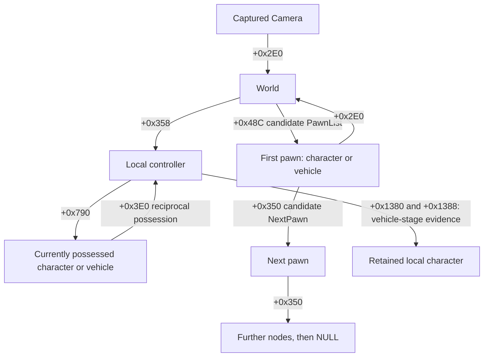

# Saved APB relationship review — 2026-09-30

## Finding

The existing captures contain a strong candidate for rooted pawn enumeration:
**Camera +0x2E0 → World; World +0x48C → first pawn; Pawn +0x350 → next pawn.**
The six identity captures reproduce null-terminated chains containing every
captured character pawn. This corrects the earlier assessment that we had no
concrete roster root. It does not establish a complete district roster or prove
that the reported acquisition defects are fixed.

The earlier diagnostic scanner in `scripts/apb_identity_inspect.py` inspected
pointer fields every eight bytes. **+0x48C is four-byte aligned**, so that scanner
never inspected this field. A pointer's storage-field alignment and its target
address alignment are separate facts. This finding proves a missed field; it
does not prove a global packing rule for every APB class.

## Collection and scope

Capture root:
`C:\Users\Admin\Documents\source_repos\drayebr\build-rpm\snapshots`

The inventory contains **5,125 files / 9,691,840,632 bytes**: 3,671 binary captures,
1,115 JSON files, 163 PNGs, 108 logs, and other traces and summaries. Files include
module pointer tables, object headers and bodies, camera/cursor records, labels,
vehicle transitions, and lifecycle evidence. This review inventories the whole
collection but analyzes the focused datasets below, rather than claiming to have
interpreted all 9.7 GB.

| Dataset | Records reviewed | Useful evidence |
|---|---:|---|
| `identity-inspect-20260930-1` through `-6` | 6 captures | Raw camera, World, controller, and pawn graphs |
| `mission-labels-20260930-2` | 14 annotations and corresponding survey headers | Another process; mixed character/vehicle links; saved World heads |
| `fresh-launch-ownership-20260930-1` | 2 annotations | Short World prefixes and character → vehicle next links |
| `vehicle-ownership-20260930-1` | 4 stages | On foot, driving stationary, driving moved, exited |

All reviewed captures identify the executable SHA-256:
`3BECA02821F50A7B8FEF3E16923FA3FCA0D0B0DD49CC9622520EA500001E1640`.
Numeric offsets and type fingerprints in this document are tied to this build.
The analysis records SHA-256 hashes for **1,516 input files** and checks raw
identity/vehicle object types and fingerprints against capture metadata.

## Measured graph and proposed field meanings



Field names such as `PawnList` and `NextPawn` are **semantic inferences** from
measured links and published engine structure. The bytes support the relationship;
we have not resolved APB reflection names for these exact fields.

| Relationship | Evidence in this review | Limit |
|---|---|---|
| Camera +0x2E0 → World | All 6 identity captures | Same process in those captures |
| World +0x358 → local controller | All 6 identity captures | Local route; not a remote-player controller roster |
| Controller +0x790 → possessed pawn; pawn +0x3E0 → controller | All 6 identity captures; all 4 vehicle stages | Possessed pawn can be a vehicle |
| World +0x48C → head; pawn +0x350 → next | 6 complete captured character chains | Full mixed roster coverage remains unverified |
| Character +0x350 → vehicle | 14 of 16 reviewed annotations | Target types captured separately within an annotation |
| Controller +0x1380/+0x1388 → character | All 4 vehicle stages | One controlled vehicle sequence |
| Character +0x88 → XYZ | Used for raw distance comparisons | Distances below are game units, not calibrated meters |

Previously documented component membership, collision bounds, cursor state,
camera projection, and mission token/side evidence remain in
`docs/APB_F8_SCANS.md`, `docs/APB_CURSOR_MEMORY.md`, and
`docs/MEMORY_COORDINATES.md`. This review does not independently revalidate all
those paths or establish death, occlusion, or complete enemy eligibility.

## Six raw identity chains

These captures span **07:31:31–07:49:10 UTC**, PID 19764, process creation filetime
134352150975111460. World remains `0x9505C90`, controller `0x9F29A040`, and local
character `0x1574F4100`. Every traversed node points back to that World at +0x2E0.
All captured object fingerprints were reported unchanged after their individual
captures, and raw fingerprints match the saved metadata.

| Capture | World +0x48C head | Captured characters | Characters reached | Termination |
|---|---|---:|---:|---|
| 1 | `0x1567E6080` | 6 | 6 | NULL |
| 2 | `0x1567E6080` | 6 | 6 | NULL |
| 3 | `0x15D6A2080` | 7 | 7 | NULL |
| 4 | `0x154633040` | 8 | 8 | NULL |
| 5 | `0x154633040` | 7 | 7 | NULL |
| 6 | `0x5980100` | 2 | 2 | NULL |

There are **36 character observations, 11 distinct observed addresses, and 30
non-null next links** across these captures. Repeated addresses are not counted
as independent players or persistent identities. Within the inspected World
prefix +0x340..+0x8FF at four-byte steps, +0x48C is the only pointer field referring
to a captured character in each of the six snapshots.

For example, capture 4 contains this measured chain:

```text
World 0x9505C90
  +0x48C → 0x154633040
  +0x350 → 0x16DD110C0
  +0x350 → 0x15D6A2080
  +0x350 → 0x160457040
  +0x350 → 0x23BB510C0
  +0x350 → 0x157B8B040
  +0x350 → 0x236597040
  +0x350 → 0x1574F4100  (local character)
  +0x350 → NULL
```

Here each successive +0x350 is read from the preceding pawn. These are heap
addresses preserved as examples, not addresses to hardcode in the product.

### Coverage caveat

The input characters were themselves discovered through a module-window survey.
Matching all captured characters proves agreement with that captured subset;
it is not an independent count of all visible players. Reads also occurred
sequentially over roughly 1–4 seconds per identity capture, rather than as atomic
process snapshots.

In the later PID 17324 mission captures, three saved World heads also occur in
their preceding survey headers and have the observed vehicle fingerprint
`(vtable RVA 0x2B29FB8, marker 6064)`. Eleven other annotation heads are absent from
those preceding surveys. These time-separated observations cannot distinguish
survey omissions from list changes between reads, but show why the arbitrary
module window cannot be treated as a proven roster.

The two fresh-launch annotations preserve only 0x100 bytes of each World, so they
cannot establish +0x48C. Vehicle stages preserve no full World body. Consequently,
this review does **not** reconstruct a complete rooted mixed chain across a
restart, district change, vehicle transition, or respawn.

## What address distances tell us

Object field offsets are distances within an object. Pointer target addresses
encode relationships between separately allocated objects. They need not be
adjacent, equally spaced, or ordered by their positions in the game world.

For the same local character in capture 4:

| Other character | Address gap from local, bytes | XYZ distance, game units |
|---|---:|---:|
| `0x157B8B040` | 6,909,760 (`0x696F40`) | 1,785.59 |
| `0x23BB510C0` | 3,831,877,568 (`0xE465CFC0`) | 871.63 |

The character separated by a much larger memory gap is closer spatially. Signed
next-link address deltas range from **−3,824,967,808 to +5,665,931,264 bytes** across
the six identity captures. These links do not form a constant-stride array.

Exploratory Spearman correlations between pairwise absolute address gaps and XYZ
distances are 0.329, 0.350, −0.099, −0.182, and −0.108 in captures 1–5. Capture 6
has only one pair. Pair endpoints and repeated captures are dependent; these are
descriptive comparisons, not significance tests or evidence of predictive power.
The saved data supplies no dependable distance formula for guessing another
player's address. Following the stored pointers is the supported operation.

## Vehicle possession explains an ownership distinction

The controlled sequence uses controller `0x38D484080` and retained character
`0x39216F040`:

| Stage | Controller +0x790 | Retained character +0x3E0 | +0x1380/+0x1388 |
|---|---|---|---|
| On foot | Character `0x39216F040` | Local controller | Character |
| Driving stationary | Vehicle `0x77F26200` | NULL | Character |
| Driving moved | Vehicle `0x77F26200` | NULL | Character |
| Exited | Character `0x39216F040` | Local controller | Character |

The possessed vehicle points back to the controller at +0x3E0. While driving,
character +0x178 points to that vehicle. On foot, +0x178 points to other captured
objects. Therefore +0x790 represents current possession and +0x350 represents a
list relationship; neither alone identifies the retained local character in all
states. These observations strengthen local ownership evidence without proving
remote-player account identity or enemy eligibility.

## Correlation with published reverse engineering

| Source | What it contributes | What it cannot establish |
|---|---|---|
| [Epic UE3 WorldInfo declarations, published source mirror](https://raw.githubusercontent.com/bakerm6/Src/master/Engine/Classes/WorldInfo.uc) | `PawnList`; `AllPawns` covers subclasses and client-relevant pawns; controller iteration has client limitations | APB numeric offsets or full district population |
| [Epic UE3 Pawn declarations, published source mirror](https://raw.githubusercontent.com/bakerm6/Src/master/Engine/Classes/Pawn.uc) | `NextPawn` is a chained list; `Controller` is current possession | APB's customized binary layout |
| [Epic UE3 Controller declarations, published source mirror](https://raw.githubusercontent.com/bakerm6/Src/master/Engine/Classes/Controller.uc) | Controller's pawn is currently controlled; replication-info relation is distinct | Remote ownership offsets in this executable |
| [Original public APB SDK generator target](https://github.com/polivilas/UnrealEngineSDKGenerator/tree/master/Target/AllPointsBulletin) | APB-specific UObject/class/property structures and reflection approach | A current SDK; it targets an older build |

The generator's [APB configuration](https://raw.githubusercontent.com/polivilas/UnrealEngineSDKGenerator/master/Target/AllPointsBulletin/Generator.cpp)
names version **1.19.4.758903**. Its
[ObjectsStore implementation](https://raw.githubusercontent.com/polivilas/UnrealEngineSDKGenerator/master/Target/AllPointsBulletin/ObjectsStore.cpp)
extracts a 32-bit address from an x86 instruction pattern. The
[official APB 1.30 announcement](https://store.steampowered.com/news/posts/?appids=113400&enddate=1680687749&feed=steam_community_announcements)
announced the move to 64-bit in February 2023. Copying old numeric layouts or
doubling all offsets would therefore require fresh evidence.

A [2011 APB forum repost](https://www.mpcforum.pl/topic/429928-apbr-kody-c-do-czego-to/)
contains a `Pawn → WorldInfo → PawnList → NextPawn` traversal. Its author says the
code was copied from another forum. It is a historical search lead; the technical
inference here relies on primary source code and our raw captures. No numeric
offset or current eligibility rule was accepted from that repost.

The UnknownCheats APB forum could not be retrieved in this session, and the
GamersFirst 64-bit discussion returned HTTP 403. These access limits leave the
forum review incomplete. No claim is made that current community research was
exhaustively reviewed.

## Pseudo operations for the next bounded validation

This is a proposed read-only validation flow, not a verified production resolver:

```text
require executable hash matches reviewed build
camera = resolve and validate the existing camera route
world = read_u64(camera + 0x2E0)
validate World fingerprint
controller = read_u64(world + 0x358)
possessed = read_u64(controller + 0x790)
validate the appropriate possession relationship

head = read_u64(world + 0x48C)       # field is not eight-byte aligned
node = head
visited = empty set
while node != NULL:
    enforce bounded node count and no cycle
    read and validate node type, signature, and node +0x2E0 == world
    next = read_u64(node + 0x350)
    if recognized character:
        record XYZ at +0x88 and separately validated classification fields
    else if recognized vehicle:
        record its type and continue traversal through it
    else:
        report unsupported node type and mark traversal incomplete
        stop                           # never publish a partial list as complete
    verify node signature and next link have not changed during this read
    visited.add(node)
    node = next

revalidate camera/world identities and head
publish only a traversal whose checks succeeded
on any failed check: emit a diagnostic and retry a fresh bounded traversal
```

Other pawn subclasses may exist. They need validated shared fields or a resolved
class hierarchy before traversal can claim complete coverage. Filtering a node
from the player results must not accidentally terminate a valid mixed chain.
Matching endpoint fingerprints and the head also cannot guarantee an atomic list;
mutation behavior still needs observation during live transitions.

The next evidence gate is a rooted capture across another launch, district
changes, respawn, and vehicle entry/exit, with an independently observed player
comparison. Only then can we judge replacing recurring broad surveys. Expected
work would scale with actual pawn nodes rather than the arbitrary module window;
no live latency, resource-use improvement, or acquisition fix is measured here.

## Reproduce and review

From the repository root, use a new output path:

```powershell
python scripts\apb_relationship_review.py --output "$env:TEMP\apb-relationship-review.json"
```

Use `--root` if the capture collection moves. The script uses Python's standard
library, reads saved files only, refuses to overwrite an existing output, and
fails visibly for missing required captures or mismatched object metadata.

Saved result: `docs/APB_RELATIONSHIP_EVIDENCE.json`.
The script completed successfully with six NULL terminations and character
counts **6, 6, 7, 8, 7, 2**. No live APB process was inspected for this review,
no new automated tests were added, and the initial offline review changed no
runtime acquisition or trigger implementation. Subsequent rooted-roster
integration and its native replay results are recorded in
`docs/MEMORY_COORDINATES.md`; live coverage remains unverified.
